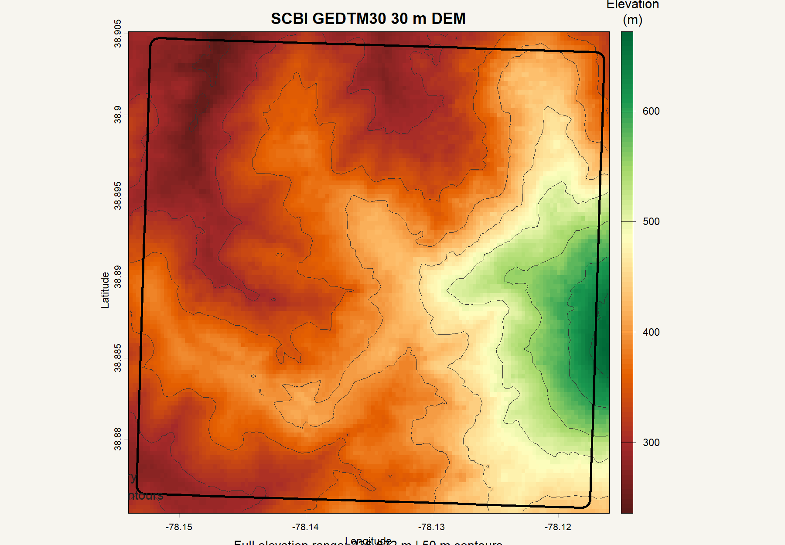

# dem30mDownloadR

`dem30mDownloadR` downloads 30 m GEDTM30 elevation data from
[OpenTopography](https://opentopography.org/) for a polygon boundary.

## Installation

```r
install.packages("remotes")
remotes::install_github("xinnix73/dem30m-download-R")
```

The package requires the spatial packages `sf` and `terra`.

## Quick start

Create a text file containing only your OpenTopography API key. The key is
read locally and is never written to output metadata.

```r
library(dem30mDownloadR)

result <- download_gedtm30(
  vector_path = "boundary.geojson",
  api_key_path = "OPENtopography_key.txt",
  output_dir = "dem-output",
  buffer_m = 60,
  resolution_m = 30
)
result$output_path
```

Use `dry_run = TRUE` to validate the boundary and inspect the request without
reading the key or downloading data. GeoJSON boundaries should use WGS84;
shapefiles must include `.shp`, `.shx`, `.dbf`, and `.prj` files.

## Included sample data

The `inst/extdata/` directory contains the sample SCBI boundary, the original
GEDTM30 GeoTIFF, and a preview image. The sample data are provided for
demonstration and testing; do not commit an API key.

### DEM overview

The following figure shows the sample 30 m DEM with hillshade and the
boundary outline.



## License

MIT.
